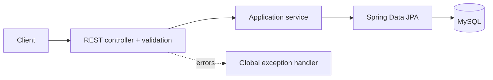

# Employee Management System

Employee directory API with validated CRUD, department, email uniqueness, paging, and role-ready security boundary.

## Assumptions and scope

- Portfolio starter, not a regulated financial/HR production system. No personal credentials or deployment are implied.
- Java 17, Spring Boot 3.3, Maven, MySQL 8.4. Tables are created with Hibernate `ddl-auto: update` for local development; use reviewed Flyway migrations and `validate` in production.
- Local compose credentials are examples only. Supply secrets via environment/secret manager outside local demos.
- For security, place this API behind an OAuth2/OIDC identity provider or add a validated JWT resource-server configuration before exposing it. No fake JWT implementation is included.

## Run

Requires Docker with Compose, or Java 17+ and Maven 3.9+. From this directory:

```bash
docker compose up --build
```

API: `http://localhost:8083`. To run directly, start MySQL and use `mvn spring-boot:run`. Environment overrides: `DB_URL`, `DB_USER`, `DB_PASSWORD`, `SERVER_PORT`.

## Endpoints

| Method | Path | Use |
|---|---|---|
| GET | `/api/v1/employees?page=0&size=20` | Page through records (max 100) |
| GET | `/api/v1/employees/{id}` | Read one |
| POST | `/api/v1/employees` | Create; validates request |
| PUT | `/api/v1/employees/{id}` | Replace editable fields |
| DELETE | `/api/v1/employees/{id}` | Delete |

Example create (employee):

```bash
curl -i http://localhost:8083/api/v1/employees -H 'Content-Type: application/json' -d '{"firstName":"Asha","lastName":"Rao","email":"asha@example.test","department":"Engineering","salary":85000.00}'
```

## Architecture



## Tests

A MockMvc request-validation test is included. Run `mvn test` to execute it. This project has not been run or verified in this environment.

## Next production steps

Add OAuth2/JWT resource-server validation and role policies; rate limits; audit trails; Flyway migrations; structured observability; integration tests with Testcontainers; and domain-specific authorization. For banking, add double-entry ledger, account ownership, balance consistency, reconciliation, and idempotency retention policies before any real-money use.
